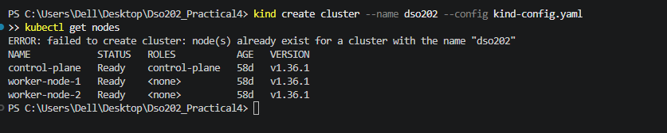
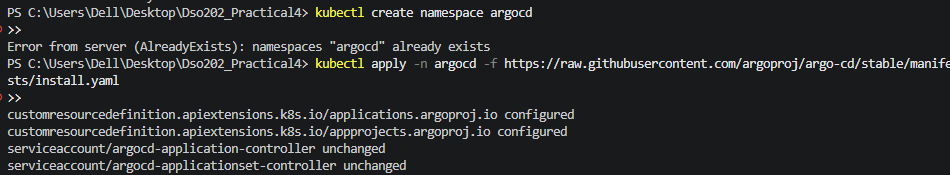
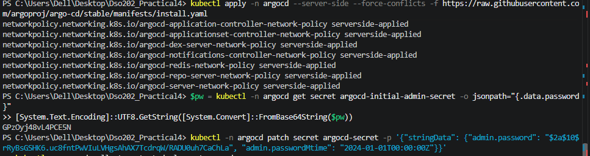
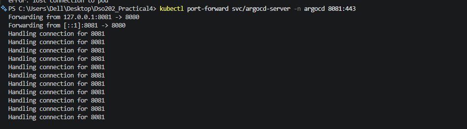
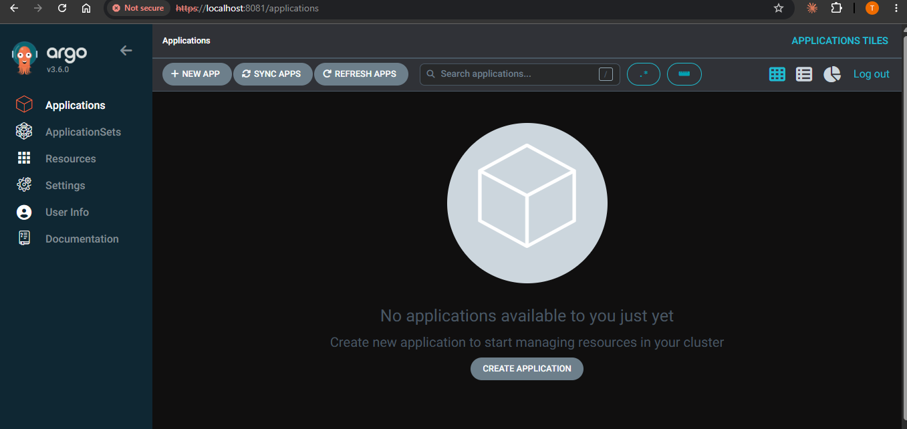
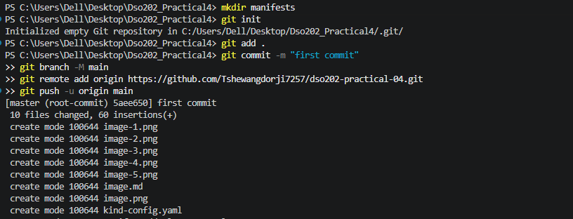
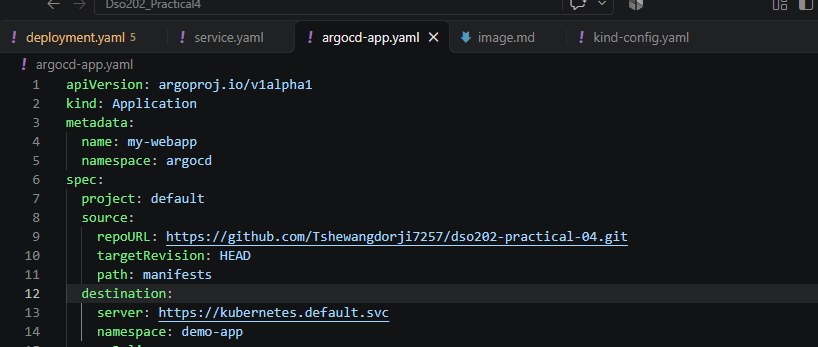
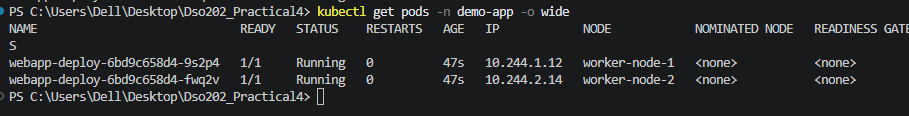
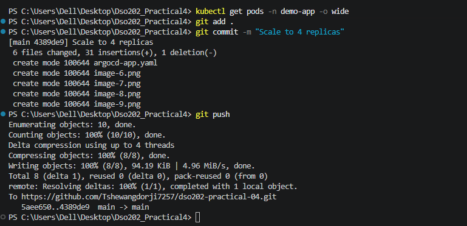
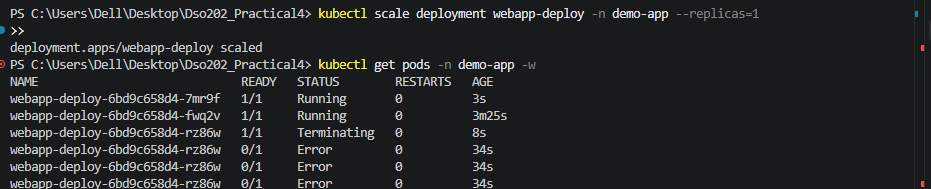

Create the Kind cluster

Install Argo CD

kubectl get pods -n argocd

Access the UI

Get the admin password:

In a separate terminal (leave it running):

Open https://localhost:8080, accept the certificate warning, and log in with username admin and the password from step 1.

Create the GitHub repo (desired state)

Register the app in Argo CD

Apply it and check

The three experiments
Experiment 1: Git as source of truth. Edit manifests/deployment.yaml, change replicas: 2 to 4, then:

Experiment 2: Self-healing. With the UI visible, run:

Experiment 3: Pruning. Delete the Service from Git: