# GitOps with Argo CD: Lab Report

## 1. Introduction

Kubernetes runs applications in containers, but it also needs a safe way to deliver changes to the cluster. In the old way, a person ran `kubectl apply` by hand, or a CI tool pushed changes into the cluster using admin credentials. This was risky. It could cause mistakes, it was hard to track who changed what, and the cluster could slowly stop matching the YAML files. This problem is called configuration drift.

GitOps solves this problem. In GitOps, all the YAML files are stored in a Git repository, and Git is the single source of truth. A tool inside the cluster pulls the files from Git and keeps the cluster the same as the repository. Argo CD is one such tool. It works like a Kubernetes controller. It compares the desired state in Git with the actual state in the cluster, and it fixes any difference.

In this practical, a Kind cluster with one control-plane node and two worker nodes was used. Argo CD was installed on it, and a sample web application was deployed from a GitHub repository. Then three experiments were done to see how Argo CD handled a change in Git, a manual change in the cluster, and a file deleted from Git.

---

## 2. Aim

The aim of this practical was to learn GitOps using Argo CD. In GitOps, Git is the single source of truth. Argo CD watches a Git repository and makes sure the Kubernetes cluster always matches what is written in Git.

## 3. Tools Used

- Docker
- Kind (Kubernetes in Docker)
- kubectl
- Git and GitHub
- Argo CD
- PowerShell on Windows

---

## 4. Procedure

### 4.1 Created the Kind Cluster

A Kind cluster named `dso202` was used. It had one control-plane node and two worker nodes. The nodes were checked with `kubectl get nodes`, and all three showed the `Ready` status.

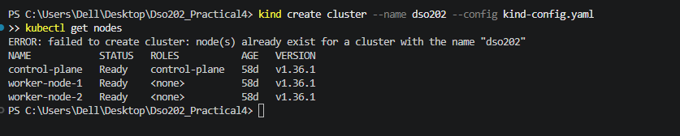

### 4.2 Installed Argo CD

A namespace called `argocd` was created. Then the official Argo CD install file was applied to the cluster. After that, the pods in the `argocd` namespace were checked with `kubectl get pods -n argocd`, and all of them were in the `Running` state.

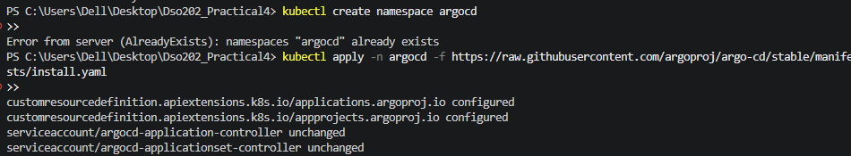

### 4.3 Accessed the Argo CD UI

The admin password was taken from the `argocd-initial-admin-secret` secret. The `base64` command did not work in PowerShell, so the password was decoded using a .NET command instead.

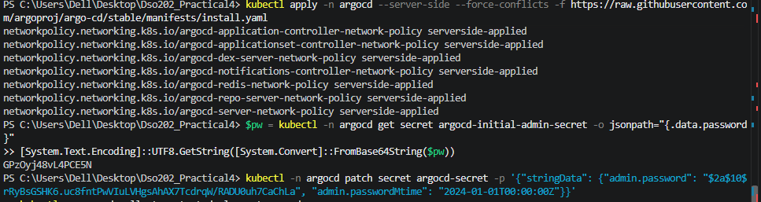

A port-forward was started in a separate terminal to reach the Argo CD server. The terminal was left running during the whole lab.

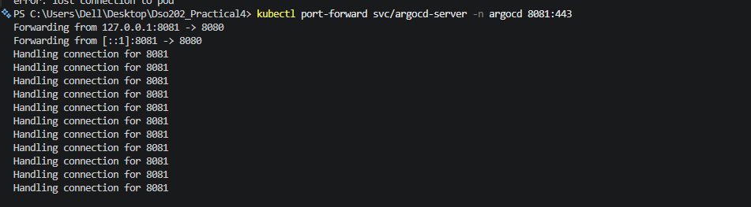

The page `https://localhost:8080` was opened in the browser. The certificate warning was accepted, and the login was done with the username `admin` and the password from the previous step.

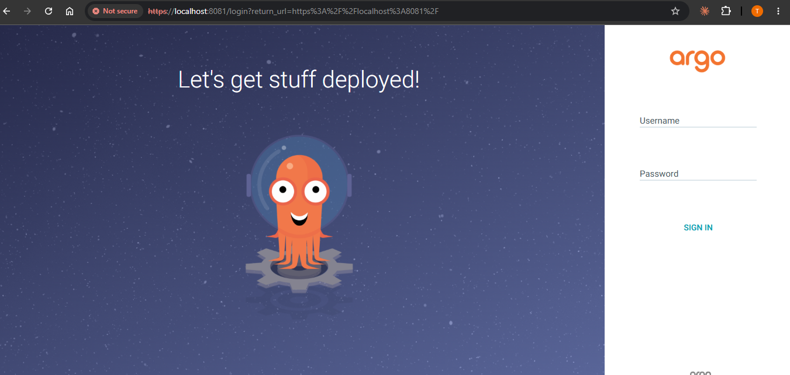
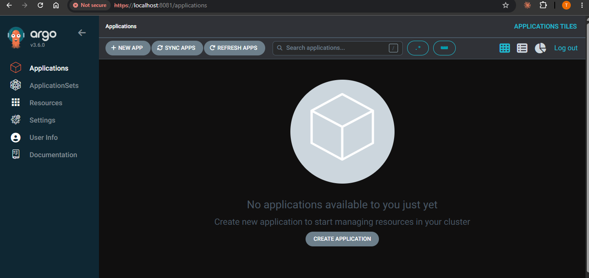

### 4.4 Created the GitHub Repository

A public GitHub repository named `dso202-practical-04` was created. A folder called `manifests` was added to it. This folder had two files:

- `deployment.yaml`: a Deployment called `webapp-deploy` with 2 replicas, using the image `nginxdemos/hello:plain-text`.
- `service.yaml`: a ClusterIP Service called `webapp-svc` on port 80.

Both files were committed and pushed to the `main` branch.

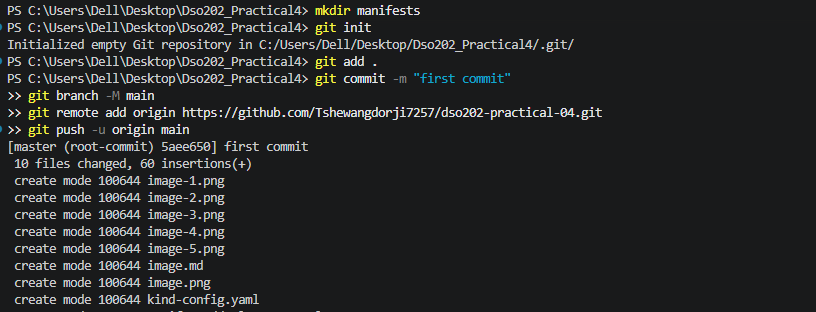

### 4.5 Registered the Application in Argo CD

A file called `argocd-app.yaml` was written. It defined an Argo CD `Application` named `my-webapp` with these settings:

- **Source:** the GitHub repository, the `manifests` folder.
- **Destination:** the local cluster, in the `demo-app` namespace.
- **Sync policy:** automated sync with `prune: true` and `selfHeal: true`, and `CreateNamespace=true`.

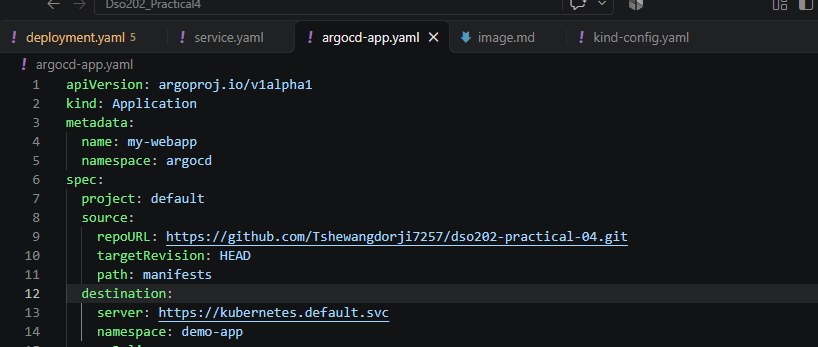

The file was applied with `kubectl apply -f argocd-app.yaml`. Argo CD then created the namespace, the Deployment, the pods and the Service by itself. The pods were checked with `kubectl get pods -n demo-app -o wide`. In the Argo CD UI, the `my-webapp` application showed as `Synced` and `Healthy`.


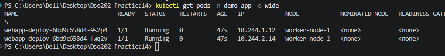

---

## 5. Experiments

### 5.1 Experiment 1: Git as the Source of Truth

The `replicas` value in `manifests/deployment.yaml` was changed from `2` to `4`. The change was committed and pushed to GitHub.

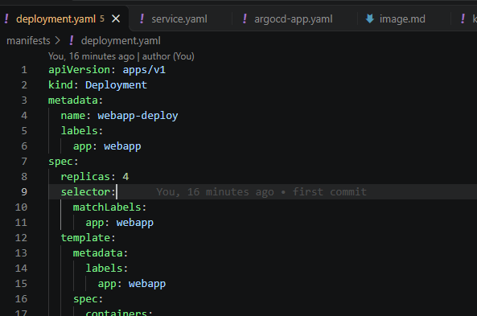
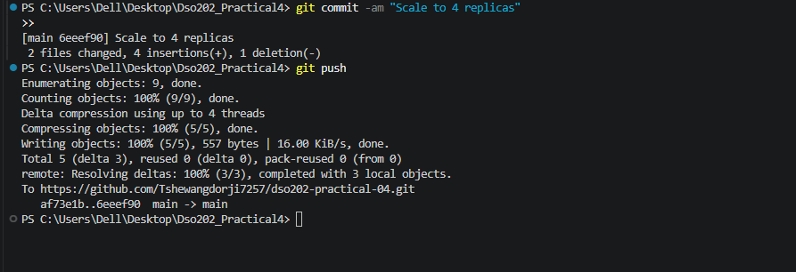

Argo CD was refreshed in the UI (it also checks GitHub on its own every 3 minutes). It found the new commit and created two more pods, so the application ended up with 4 running pods.

**Result:** A change made in Git was applied to the cluster automatically. No `kubectl` command was needed.

### 5.2 Experiment 2: Configuration Drift and Self-Healing

To act like a person who changes the cluster by hand, the Deployment was scaled down using `kubectl`:

```powershell
kubectl scale deployment webapp-deploy -n demo-app --replicas=1
```

Some pods began to terminate. Argo CD noticed that the cluster no longer matched Git. Because `selfHeal` was turned on, it undid the manual change and brought the replicas back to the number written in Git.

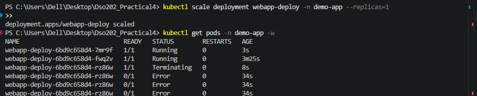

**Result:** The manual change was reverted automatically. This showed that self-healing prevents configuration drift.

### 5.3 Experiment 3: Automatic Pruning

The file `manifests/service.yaml` was deleted from the repository. The deletion was committed and pushed.

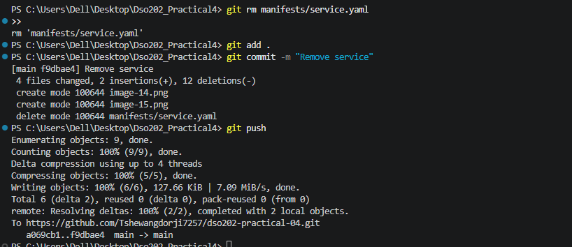

Argo CD was refreshed, and then `kubectl get svc -n demo-app` was run. The result was `No resources found`, so the `webapp-svc` Service had been deleted from the cluster.

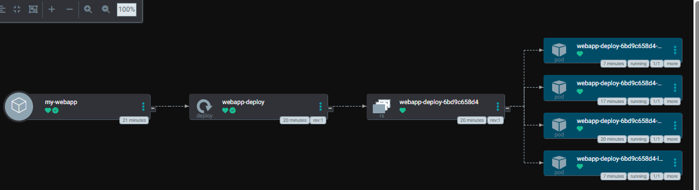
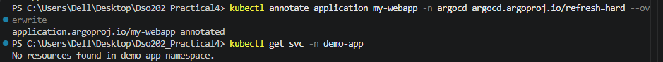

**Result:** Because `prune` was turned on, deleting a file from Git also deleted the matching resource from the cluster.

### 5.4 Restoring the Service

The deleted `service.yaml` file was brought back through a new Git commit and pushed to GitHub.

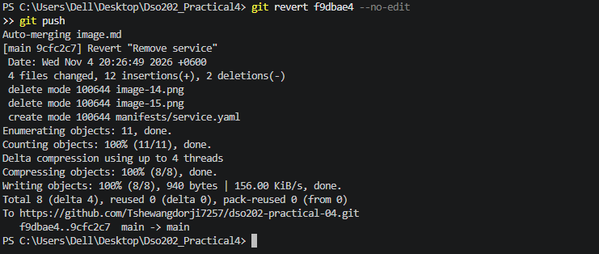

A hard refresh was forced on the application with this command:

```powershell
kubectl annotate application my-webapp -n argocd argocd.argoproj.io/refresh=hard --overwrite
```

After that, `kubectl get svc -n demo-app` was run again, and the `webapp-svc` Service was back in the cluster.

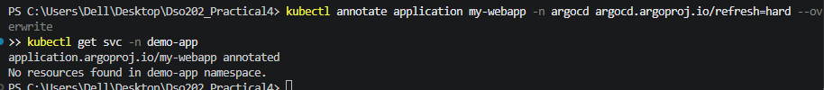
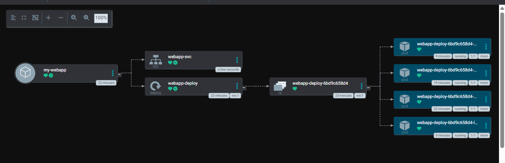

**Result:** Restoring the file in Git was enough to restore the Service. This showed that Git history works as a simple rollback tool.

---

## 6. Problems Faced and Fixes

| Problem | Cause | Fix |
|---|---|---|
| `kind create cluster` said the cluster already existed | The `dso202` cluster had been created earlier | The existing cluster was used |
| `base64` was not recognized | `base64` is a Linux command and does not exist in PowerShell | The password was decoded using `[System.Convert]::FromBase64String` |
| `applicationsets.argoproj.io` CRD was invalid ("annotations too long") | A known limit of `kubectl apply` on a very large CRD | It did not affect the lab; server-side apply can fix it |
| Service still existed right after the push | Argo CD only checks GitHub every 3 minutes | A manual refresh was done |
| `git revert` failed | Uncommitted changes existed in `image.md` | The changes were committed first, or only the needed file was restored |

---

## 7. Observations

- Argo CD kept the cluster the same as the Git repository at all times.
- Every change was made through Git, so every change had a commit, an author and a time.
- Manual changes made with `kubectl` were reverted automatically.
- Deleting a file in Git removed the resource from the cluster.

## 8. Conclusion

In this practical, GitOps was done using Argo CD on a Kind cluster. Argo CD was installed, a GitHub repository was connected to it, and an application was deployed from Git. Three experiments were performed. They showed that Git is the single source of truth, that self-healing fixes manual changes, and that pruning removes resources that are deleted from Git. The practical showed that GitOps makes deployments safer, easier to track and easier to roll back.